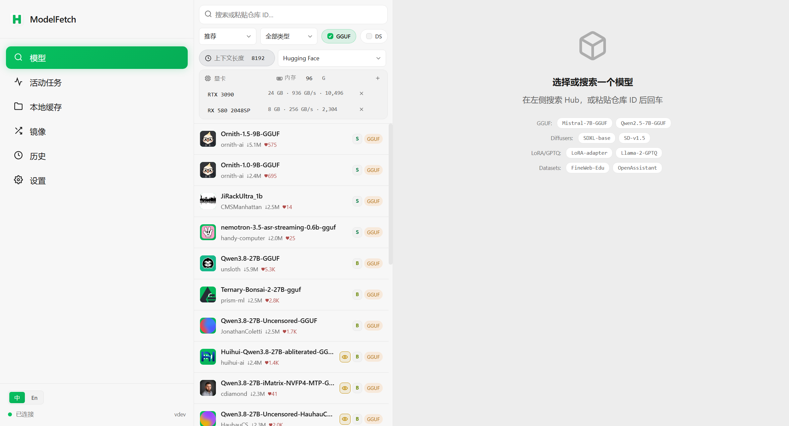
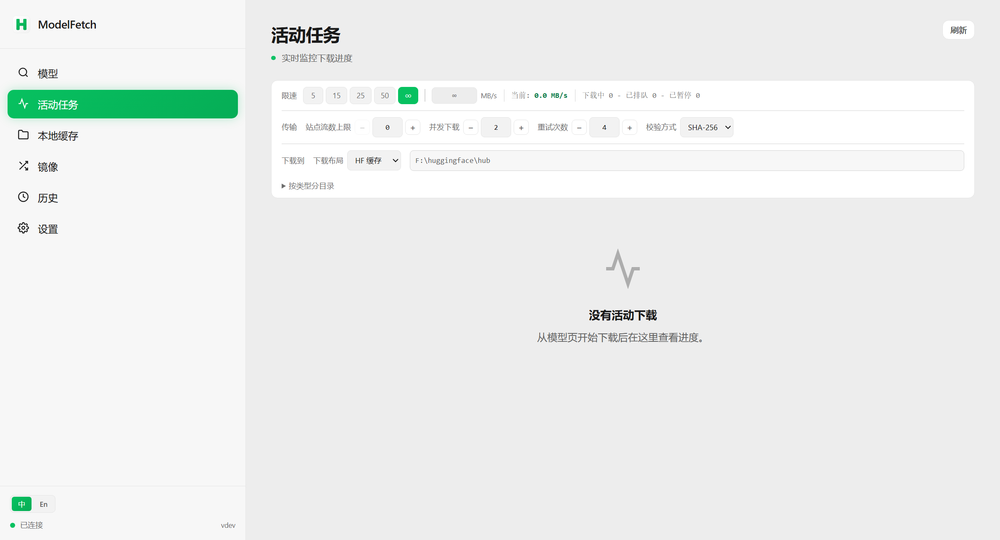
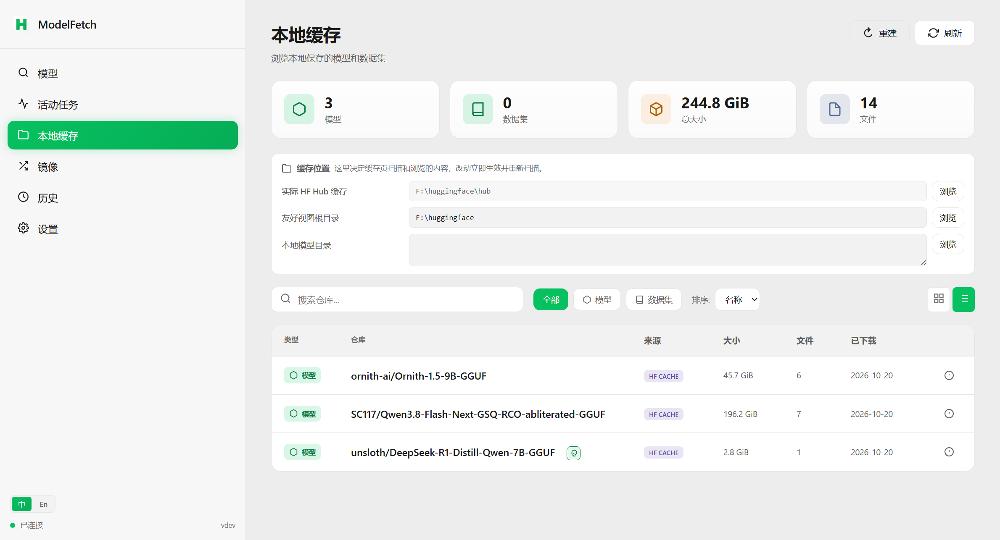
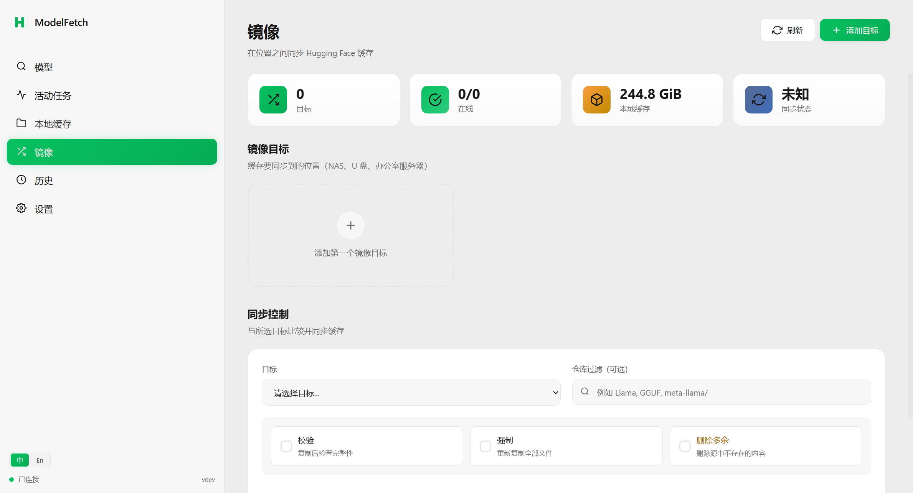
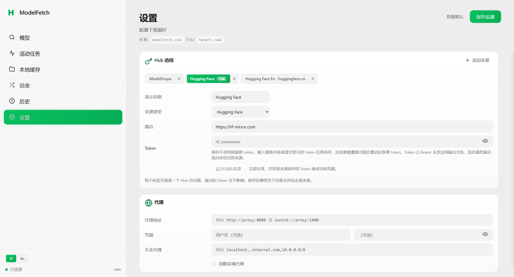

# ModelFetch

**本地优先的 Hugging Face / ModelScope 模型工作台** — 搜索、分析、下载、缓存管理一体化。
*A focused local dashboard for finding, analyzing, and downloading Hugging Face and ModelScope models.*

<p align="center">
  <a href="https://github.com/bashrusakh/modelfetch/releases"></a>
  <a href="https://pkg.go.dev/github.com/bashrusakh/modelfetch"></a>
  <a href="LICENSE"></a>
</p>

<p align="center">
  
</p>

ModelFetch 是一个单文件 Go 程序,内置 Web 界面(微信风格浅色主题)。启动后在浏览器里完成整个模型工作流:搜索 Hub、分析 GGUF 量化、挑选文件、断点续传下载、浏览本地缓存、把缓存镜像到 NAS 或另一块盘。

## 功能特性

- **多来源搜索** — 默认源是 ModelScope(`modelscope.cn`),可切到 Hugging Face(端点默认 `hf-mirror.com` 镜像,可换官方端点或自定义镜像);每个源单独保存端点与 token,切换时凭证跟着源走。支持关键词、推荐排序、下载量排序、GGUF/DS 过滤;来源做不到的事(没有某种排序、单页数量上限)会在结果上方说明,不会静默替换。
- **仓库分析** — 下载前查看文件树、提交信息、README 预览;GGUF 分片文件自动归并为一个量化选项,附 RAM 估算、硬件适配等级与推荐档位。
- **可靠下载** — 并行分块、断点续传、自动重试、限速、每主机流数上限;活动任务页实时进度、速度、暂停/取消/重试。
- **本地缓存浏览** — 识别标准 HF 缓存、友好目录和 LM Studio 风格模型文件夹;按类型、大小、来源过滤,卡片/表格两种视图,支持删除与重建脚本导出。
- **缓存完整性校验** — 缓存里的文件被截断、被坏盘清零或被手改过,名字不变、看起来仍是「已下载」。校验按缓存自身的规则核对:快速一遍只看文件名与大小,逐字节一遍把每个文件重新计算 SHA-256 并与它存储的名字比对,列出对不上的文件。整轮可中断,进度按仓库实时显示。
- **镜像同步** — 把缓存内容同步到 NAS、U 盘或另一台机器,增量对比缺失/多余/过期文件;写入是一次可中断、页面关掉再打开也能接回的任务,进度显示正在写哪个仓库,结束时说明实际复制/删除了什么。
- **历史记录与磁盘水位** — 每次下载留痕,盘余量指示器随目录实时更新。
- **网络适配** — 代理(HTTP/SOCKS5)与 token 支持;组织头像等图片在镜像端点下自动钉到可达主机。
- **中英双语界面** — 默认中文,侧边栏底部切换并按浏览器记忆选择。
- **单二进制部署** — 前端资源编译期内嵌,无外部依赖;Docker 镜像一条卷即可持久化全部状态。

## 安装

预编译二进制随 tag 发布,见 [Releases](https://github.com/bashrusakh/modelfetch/releases)。那一页为空说明还没有推过 `v*` tag,此时从源码安装:

```bash
go install github.com/bashrusakh/modelfetch/cmd/modelfetch@latest
```

Docker(全部状态挂在一条 `/data` 卷下)。`ghcr.io/bashrusakh/modelfetch` 的镜像同样由 tag 触发构建,还没有镜像时先本地构建:

```bash
docker build -t modelfetch:local .
docker run --rm -p 8080:8080 -v modelfetch-data:/data modelfetch:local
```

已发布时用镜像仓库的地址:

```bash
docker run --rm -p 8080:8080 \
  -v modelfetch-data:/data \
  ghcr.io/bashrusakh/modelfetch:latest
```

NAS/群晖环境常用 UID/GID 选项(`PUID`/`PGID`,默认 1000)与 `UMASK`(默认 022)由镜像入口处理,行为与默认值写在 `docker/entrypoint.sh` 顶部,并由 `docker/smoke-test.sh` 逐条验证。

## 快速开始

```bash
modelfetch
```

默认监听 `0.0.0.0:8080`(同一局域网里的其他设备也能访问),并在本机自动打开 `http://localhost:8080`。只想给本机用就加 `--bind 127.0.0.1`,桌面客户端正是这样启动 sidecar 的。常用参数:

```text
--port 9090              指定端口(0 由系统分配空闲端口)
--bind 127.0.0.1         只监听本机(默认 0.0.0.0)
--no-open                不自动打开浏览器
--token hf_xxx           Hugging Face token(也可用 HF_TOKEN 环境变量)
--cache-dir /mnt/ssd/huggingface   指定 Hugging Face 缓存目录
--local-dir /mnt/models  实体文件写入该目录(LM Studio 风格,不走 HF 缓存布局)
--stall-timeout 60s      下载读取停滞超过该时长即中断重试(0 关闭)
```

## 配置

配置文件按这个顺序查找:启动目录 → 可执行文件所在目录 → 用户配置目录(`%APPDATA%\ModelFetch`、`~/Library/Application Support/ModelFetch`、`~/.config/ModelFetch`),三处都找 `modelfetch.json` / `modelfetch.yaml` / `modelfetch.yml`。三处都没有现成文件时,UI 里保存会在用户配置目录新建一个;只有启动目录或可执行文件旁边已经有配置文件,保存才写回那里。示例:

```json
{
  "token": "hf_xxx",
  "cache-dir": "/mnt/ssd/huggingface",
  "endpoint": "https://hf-mirror.com",
  "connections": 8,
  "max-active": 3,
  "max-streams-per-host": 8,
  "multipart-threshold": "32MiB",
  "verify": "sha256",
  "retries": 4,
  "proxy": {
    "url": "socks5://proxy.internal:1080",
    "username": "user",
    "password": "pass",
    "no_proxy": "localhost,127.0.0.1"
  }
}
```

要点:

- `connections` 是单个大文件的并行连接数;`max-streams-per-host` 限制整个进程对同一 Hub 主机的并发下载流总数,留空或 `0` 时等于 `connections`。多任务同时下载时,每个任务约占 `max-streams-per-host / max-active` 路。
- token 解析顺序:`--token` 参数 → `HF_TOKEN` 环境变量 → 配置文件 `token` 字段。UI 里保存 token 时,空串表示清除、字段缺省表示保留。
- 存储根:`--cache-dir` 决定友好目录(`models/`、`datasets/`)所在的应用根;`HF_HUB_CACHE` 非空时始终精确指定 Hub 目录本身,不随应用根移动。两者可以分居两块盘,已有任务会冻结各自的落盘路径,重启与暂停/重试不漂移。
- 配置文件可能包含明文凭证,ModelFetch 写盘时默认 `0600` 权限;保存失败会在 UI 提示,修复权限后重新保存即可。

## 界面截图

| 模型 | 活动任务 |
|---|---|
|  |  |

| 本地缓存 | 镜像 |
|---|---|
|  |  |

| 设置 |
|---|
|  |

## API

Web 界面背后是一组本机 JSON API,只监听本机进程所在端口(见 `--bind`)。端点注册在 `internal/server/routes.go`,请求与响应的字段形状在 `internal/server/api_types.go` 与各 handler 里;仓库不再维护单独的 API 文档,代码就是契约。

## 构建

```bash
git clone https://github.com/bashrusakh/modelfetch
cd modelfetch

# 构建前端(输出编译期内嵌进二进制)
cd web && npm install && npm run build && cd ..

# 构建后端
go build -o modelfetch ./cmd/modelfetch
./modelfetch
```

前端开发(热更新,需后端同时运行):

```bash
cd web && npm run dev
```

测试:

```bash
go test ./...
go test ./... -race
cd web && npm test
```

## 版本

当前版本 **0.0.1**。版本号只有一个来源:仓库根目录的 `VERSION` 文件。构建时以 `-ldflags "-X main.Version=$(cat VERSION)"` 注入,`modelfetch --version`、`GET /api/health` 的 `version` 字段与界面里显示的是同一个值;没有注入的本地构建显示 `dev`。

项目从 0.0.1 起重新计数。此前的 1.x 编号只存在于提交历史里(`git log`),不再有单独的 changelog 文件:每版改了什么由提交记录与 pull request 说明。0.x 阶段不承诺 API 向后兼容,接口的实际形状以 `internal/server/` 里的 handler 与响应结构为准。

发布由打 tag 触发:推送 `v*` 会运行 [.github/workflows/release.yml](.github/workflows/release.yml)(各平台二进制、Linux RPM、校验和,并创建 GitHub Release)与 [.github/workflows/docker-publish.yml](.github/workflows/docker-publish.yml)(GHCR 镜像)。

## 致谢与许可

ModelFetch 是 [bodaay/HuggingFaceModelDownloader](https://github.com/bodaay/HuggingFaceModelDownloader) 的 fork,保留原始版权与许可声明。以 [Apache License 2.0](LICENSE) 授权。
