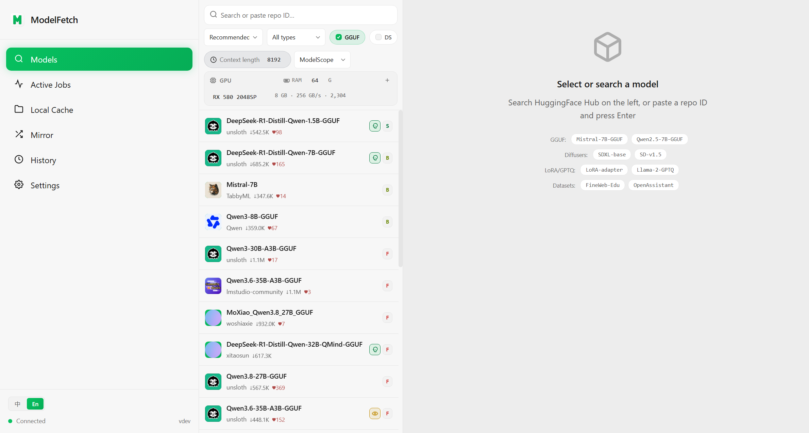
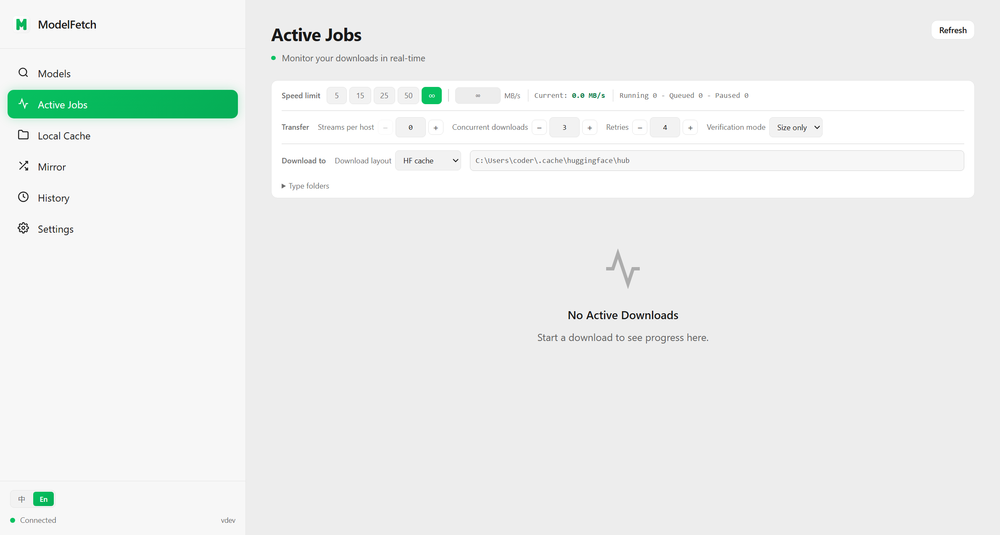
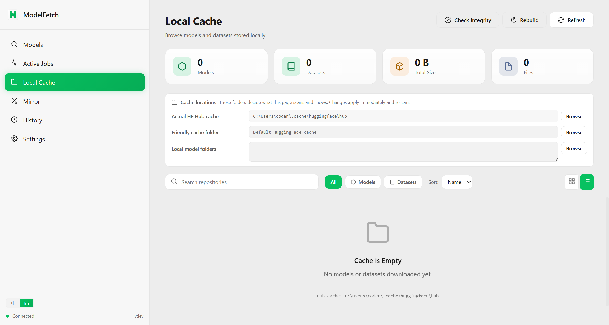
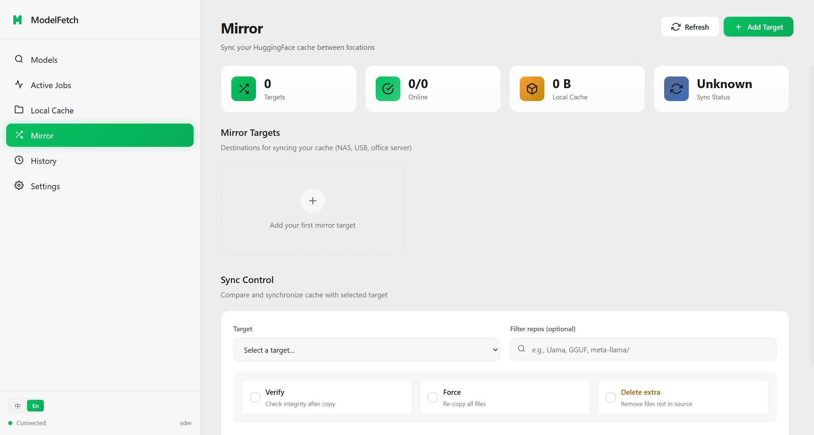
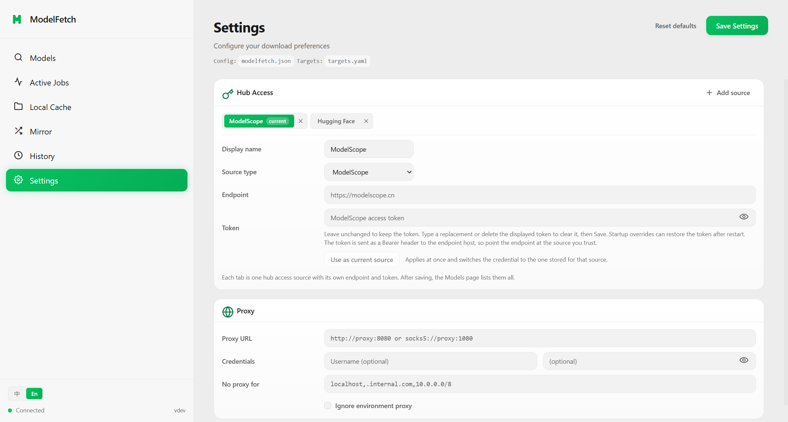

# ModelFetch

**A local-first workspace for Hugging Face / ModelScope models** — search, analyze, download, and manage your cache in one place.

English | [简体中文](README.zh-CN.md)

<p align="center">
  <a href="https://github.com/SnailStudioX/model-fetch/releases"></a>
  <a href="https://pkg.go.dev/github.com/SnailStudioX/model-fetch"></a>
  <a href="LICENSE"></a>
</p>

<p align="center">
  
</p>

ModelFetch is a single Go binary with a built-in web UI (a light theme in the style of WeChat). Start it and the whole model workflow happens in the browser: search a hub, analyze GGUF quantizations, pick the files you want, download with resume, browse the local cache, and mirror that cache to a NAS or another disk.

## Features

- **Multiple hub sources** — ModelScope (`modelscope.cn`) is the default; switch to Hugging Face at any time (its endpoint defaults to the `hf-mirror.com` mirror, and the official endpoint or any custom mirror works too). Each source keeps its own endpoint and token, and the credential follows the hub when you switch. Keyword search, recommended and download-count ordering, GGUF/dataset filters. When a source cannot do what was asked — an order it does not offer, a page size it caps — the page says so above the results instead of quietly substituting.
- **Repository analysis** — the file tree, commit info and README preview before you download anything. Split GGUF shards are folded into one quantization option, with a RAM estimate, a hardware-fit grade for this machine and a recommended pick.
- **Dependable downloads** — parallel chunking, resume, automatic retries, a speed limit, and a cap on streams per host. The Jobs page shows live progress and speed per file, with pause, cancel and retry.
- **Local cache browsing** — recognizes the standard HF cache, the friendly view directories and LM Studio-style model folders; filter by type, size and origin, switch between card and table views, delete selections, and export a rebuild script.
- **Cache integrity check** — a file truncated by an interrupted copy, zeroed by a failing disk, or edited by hand keeps its name and still looks downloaded. The check asks the cache's own question: a quick pass reads names and sizes only, a byte pass re-reads every file and compares the SHA-256 it computes with the name it is stored under, then lists what disagrees. It can be stopped at any point, and progress moves one repository at a time.
- **Mirror sync** — copy cache contents to a NAS, a USB drive or another machine, comparing what is missing, extra or outdated. A write sync is a task: it can be interrupted, a page closed mid-copy reattaches to it, the progress names the repository being written, and the result says what was actually copied or removed.
- **Download history and disk levels** — every download is recorded, and the free-space indicator follows the directory you are looking at.
- **Network fit** — proxy (HTTP/SOCKS5) and token support; organization avatars and other card images are pinned to a reachable host when a mirror endpoint is in use.
- **Bilingual UI (Chinese / English)** — Chinese by default, switched from the bottom of the sidebar and remembered per browser.
- **Single-binary deployment** — the frontend is embedded at build time, no external assets; one Docker volume holds all state.

## Install

Pre-built binaries are published from tags — see [Releases](https://github.com/SnailStudioX/model-fetch/releases). If that page is empty, no `v*` tag has been pushed yet, so install from source:

```bash
go install github.com/SnailStudioX/model-fetch/cmd/modelfetch@latest
```

Docker, with all state under one `/data` volume. The image is published by the same tag trigger, and the registry is public — no login:

```bash
docker run --rm -p 8080:8080 \
  -v modelfetch-data:/data \
  ghcr.io/snailstudiox/model-fetch:latest
```

An image built from this checkout behaves the same, which is what you want with local changes:

```bash
docker build -t modelfetch:local .
docker run --rm -p 8080:8080 -v modelfetch-data:/data modelfetch:local
```

The UID/GID options NAS and Synology setups usually need (`PUID`/`PGID`, default 1000) and `UMASK` (default 022) are handled by the image entrypoint; its header in `docker/entrypoint.sh` states the behavior and defaults, and `docker/smoke-test.sh` exercises them one case at a time.

## Quick start

```bash
modelfetch
```

It listens on `0.0.0.0:8080` by default (so other devices on the same LAN can reach it) and opens `http://localhost:8080` on the machine it runs on. Pass `--bind 127.0.0.1` to keep it local only — that is how the desktop client starts its sidecar. Common flags:

```text
--port 9090              choose a port (0 lets the OS pick a free one)
--bind 127.0.0.1         listen on loopback only (default 0.0.0.0)
--no-open                do not open a browser
--token hf_xxx           Hugging Face token (HF_TOKEN in the environment works too)
--cache-dir /mnt/ssd/huggingface   the Hugging Face cache directory
--local-dir /mnt/models  write real files here instead (LM Studio style, not the HF cache layout)
--stall-timeout 60s      abort and retry a download read that delivers no bytes for this long (0 disables)
```

## Configuration

Config files are looked for in this order: the working directory → the directory holding the executable → the user configuration directory (`%APPDATA%\ModelFetch`, `~/Library/Application Support/ModelFetch`, `~/.config/ModelFetch`), trying `modelfetch.json` / `modelfetch.yaml` / `modelfetch.yml` in each. When none of them exists, saving from the UI creates one in the user configuration directory; it writes back to the working directory only when a config file already exists there (or beside the executable). Example:

```json
{
  "token": "hf_xxx",
  "cache-dir": "/mnt/ssd/huggingface",
  "endpoint": "https://hf-mirror.com",
  "connections": 8,
  "max-active": 3,
  "max-streams-per-host": 8,
  "multipart-threshold": "32MiB",
  "verify": "sha256",
  "retries": 4,
  "proxy": {
    "url": "socks5://proxy.internal:1080",
    "username": "user",
    "password": "pass",
    "no_proxy": "localhost,127.0.0.1"
  }
}
```

Notes:

- `connections` is how many parallel connections one large file uses. `max-streams-per-host` caps the total number of download streams this process opens against one hub host, across every job and file; empty or `0` means it follows `connections`. With several jobs running, each one gets roughly `max-streams-per-host / max-active` streams.
- Token resolution order: the `--token` flag → the `HF_TOKEN` environment variable → the `token` field of the config file. When the UI saves a token, an empty string clears it and an omitted field keeps the current one.
- Storage roots: `--cache-dir` decides the application root the friendly view (`models/`, `datasets/`) sits under; a non-empty `HF_HUB_CACHE` always names the hub directory itself and does not move with that root. The two may live on different disks, and existing jobs freeze the paths they were writing to, so a restart or a pause/resume does not drift.
- A config file can hold plain-text credentials, so ModelFetch writes it with `0600` permissions by default. A failed save is reported in the UI; fix the permissions and save again.

## Screenshots

The interface is bilingual, and each readme shows its own language. Capture them
with the app running: `npm run shots -- --lang=en` here, `npm run shots` for the
Chinese set in [README.zh-CN.md](README.zh-CN.md).

| Models | Jobs |
|---|---|
|  |  |

| Local cache | Mirror |
|---|---|
|  |  |

| Settings |
|---|
|  |

## API

The web UI talks to a set of local JSON endpoints served on the same port (see `--bind`). Routes are registered in `internal/server/routes.go`; request and response shapes live in `internal/server/api_types.go` and in the handlers themselves. There is no separate API document — the code is the contract.

## Build

```bash
git clone https://github.com/SnailStudioX/model-fetch.git
cd model-fetch

# build the frontend (its output is embedded into the binary at build time)
cd web && npm install && npm run build && cd ..

# build the backend
go build -o modelfetch ./cmd/modelfetch
./modelfetch
```

Frontend development (hot reload, needs the backend running too):

```bash
cd web && npm run dev
```

Tests:

```bash
go test ./...
go test ./... -race
cd web && npm test
```

## Version

The current version is **0.0.1**, and it has exactly one source: the `VERSION` file at the repository root. It is injected at build time with `-ldflags "-X main.Version=$(cat VERSION)"`, so `modelfetch --version`, the `version` field of `GET /api/health` and whatever the UI shows are the same value; a local build without that injection reports `dev`.

Numbering restarts at 0.0.1. The earlier 1.x numbers exist only in the commit history (`git log`); there is no changelog file — what changed in a release is described by its commits and pull requests. While the version is 0.x no API compatibility is promised; the actual shape of each endpoint is whatever the handlers in `internal/server/` return.

Releases are produced by pushing a tag: a `v*` push runs [.github/workflows/release.yml](.github/workflows/release.yml) (binaries per platform, a Linux RPM, checksums, and the GitHub Release) and [.github/workflows/docker-publish.yml](.github/workflows/docker-publish.yml) (the GHCR image).

## Acknowledgments and license

ModelFetch is a fork of [bodaay/HuggingFaceModelDownloader](https://github.com/bodaay/HuggingFaceModelDownloader), keeping its original copyright and license notices. Licensed under the [Apache License 2.0](LICENSE).
